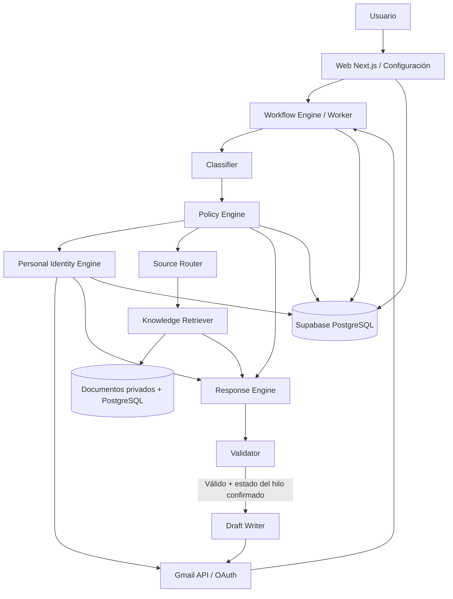

# MAIL-003 — Arquitectura funcional: identidad, conocimiento y autorización

**Versión:** 1.0 · **Fecha:** 14/10/2026 · **Estado:** Arquitectura base decidida, interfaces sujetas a revisión durante implementación.

## 1. Decisión arquitectónica (ADR-001)

**Adoptar un monolito modular TypeScript** con Next.js (web + endpoints), worker Node.js, PostgreSQL/Supabase, Google Gmail API y OpenAI API. No montar microservicios, LangChain obligatorio, n8n, fine-tuning, vector DB ni plataforma de agentes autónomos para la primera versión.

**Motivo:** aislar módulos funcionales sin la sobrecarga operacional de varios servicios. Los componentes exponen interfaces testables e inyectables; el worker puede reusarlos directamente.

**Ámbito de responsabilidad:** la plataforma controla cuándo y con qué permisos se ejecuta cada operación. El modelo solo ayuda a clasificar/redactar y nunca es la fuente final de permisos o verdad empresarial.

## 2. Diagrama lógico



**Observación:** el `Policy Engine` debe volver a ejecutarse después de la generación. Los módulos separados NO necesitan procesos independientes.

## 3. Componentes y límites

| Módulo | Responsabilidad propia | Entradas | Salidas | Prohibiciones |
|---|---|---|---|---|
| `auth` | Sesión de usuario de la app | Credenciales/identidad | Usuario autenticado | No usar sesión Gmail como sesión web implícita |
| `gmail` | OAuth offline, leer perfiles/mensajes/hilos, crear borradores | Cuenta autorizada y `messageId/threadId` | Mensajes normalizados, `draftId` | Ninguna ruta de envío o borrado de emails |
| `workflow` | Polling, cola, estados, idempotencia, revalidación | Novedades Gmail, ajustes | Trabajo final y motivo | No inferir hechos ni redactar |
| `classifier` | Intención y necesidad aparente de respuesta | Mensaje/hilo limpio | Decisión e intenciones | No conceder permisos ni crear drafts |
| `identity` | Construir/seleccionar Style Memory | Mensajes `SENT` elegidos, usuario, destinatario | Perfil y ejemplos relevantes | No establecer hechos actuales desde el estilo |
| `knowledge` | Buscar evidencia factual autorizada | Pregunta, reglas, fuentes accesibles | Fragmentos con procedencia/vigencia | No acceder a fuentes fuera de autorización |
| `source-router` | Decidir orden de recuperación | Intención, reglas | Fuentes priorizadas/autorizadas | No buscar indiscriminadamente en todo |
| `policy` | Elegibilidad, riesgos, permisos, acciones permitidas | Clasificación, hechos, ajustes, estado | `ALLOW_DRAFT/REVIEW/SKIP` y razones | No delegar autoridad al LLM |
| `response` | Redactar con estilo y evidencia | Contexto validado | Borrador estructurado | No ejecutar escritura Gmail ni herramientas externas |
| `validator` | Validación de formato, hechos y restricciones | Salida y evidencia | Resultado validado o bloqueo | No dar por confirmado un hecho solo por «confianza» del modelo |
| `analytics` | Contadores, costes, feedback permitido | Metadatos y eventos | Métricas agregadas | No coleccionar cuerpos permanentemente |

## 4. Interfaces de dominio sugeridas (contratos TypeScript)

Estas firmas son un **contrato conceptual**; Codex puede refinarlas manteniendo los invariantes.

```ts
type GmailMessageId = string;
type GmailThreadId = string;
type UserId = string;

type EmailMessage = {
  id: GmailMessageId;
  threadId: GmailThreadId;
  from: string;
  to: string[];
  cc: string[];
  subject: string;
  internetMessageId?: string;  // Message-ID RFC
  references?: string[];
  inReplyTo?: string;
  receivedAt: string;
  bodyText: string;              // solo en memoria operacional por defecto
  hasAttachments: boolean;
  labels: string[];
};

type ThreadContext = {
  accountId: string;
  threadId: GmailThreadId;
  targetMessageId: GmailMessageId;
  messages: EmailMessage[];
  isAlreadyAnswered: boolean;
  hasManualDraft: boolean;
};

type Classification = {
  decision: 'REPLY_REQUIRED' | 'NO_REPLY' | 'UNCERTAIN';
  intent: string;
  requiredTopics: string[];
  risks: string[];
  reasons: string[];
};

type StyleContext = {
  profileVersion: number;
  description: string;
  explicitPreferences: string[];
  relationshipHints: string[];
  examples: { messageId: GmailMessageId; excerpt: string }[];
};

type Evidence = {
  sourceId: string;
  chunkId: string;
  citation: string;  // documento, sección y versión
  text: string;
  verifiedCurrent: boolean;
};

type PolicyResult = {
  action: 'ALLOW_DRAFT' | 'REVIEW_REQUIRED' | 'SKIP';
  reasons: string[];
  allowedSourceIds: string[];
};

type GeneratedDraft = {
  status: 'READY' | 'INSUFFICIENT_CONTEXT' | 'BLOCKED';
  bodyText?: string;
  evidenceIds: string[];
  warnings: string[];
};

interface GmailGateway {
  listCandidateMessageIds(accountId: string, since: string): Promise<string[]>;
  getThreadContext(accountId: string, targetMessageId: string): Promise<ThreadContext>;
  createDraftReply(accountId: string, context: ThreadContext, body: string): Promise<{ draftId: string }>;
}

interface StyleMemory {
  rebuildProfile(userId: UserId, sourceMessageIds: string[]): Promise<StyleContext>;
  selectContext(userId: UserId, thread: ThreadContext): Promise<StyleContext>;
}

interface KnowledgeGateway {
  retrieve(userId: UserId, topics: string[], allowedSourceIds: string[]): Promise<Evidence[]>;
}

interface ResponseGenerator {
  generate(input: {
    thread: ThreadContext;
    classification: Classification;
    style: StyleContext;
    evidence: Evidence[];
    userInstructions: string[];
  }): Promise<GeneratedDraft>;
}
```

**Importante:** `EmailMessage.bodyText` y `StyleContext.examples[].excerpt` no deben serializarse a una base o log por defecto: son objetos transitorios y deben evitar persistencia implícita (errores, APM, request dumps).

## 5. Secuencia detallada de un nuevo correo

1. `Worker` adquiere lock por cuenta y detecta IDs nuevos.
2. Registra `email_jobs(accountId, targetMessageId)` bajo índice único.
3. Comprueba ajustes del usuario y exclusiones mediante metadatos cuando sea posible.
4. `GmailGateway` recupera conversación actual y cuerpo mínimo necesario.
5. Comprueba si hay respuesta o draft previos.
6. `Classifier` propone `NO_REPLY`, `UNCERTAIN` o `REPLY_REQUIRED` con razones.
7. `PolicyEngine.preflight` evalúa riesgo, destinatarios, límites, adjuntos y permisos.
8. `StyleMemory.selectContext` genera perfil/selecciona ejemplos, recuperándolos en Gmail cuando sea necesario.
9. `SourceRouter` elige conjuntos de documentos permitidos según intención y reglas.
10. `KnowledgeGateway` devuelve fragmentos con identidad de documento, versión y autoridad.
11. `ResponseGenerator` crea una respuesta usando solo entradas necesarias; su salida es un esquema validado.
12. `Validator` comprueba hechos críticos, ausencia de promesas inventadas, idioma, destinatario y política final.
13. `GmailGateway` vuelve a consultar el hilo para detectar cambios.
14. Bajo control de idempotencia, `DraftWriter` crea el draft con `threadId`, `Subject`, `References` e `In-Reply-To` apropiados.
15. Se registran `draftId`, estados, fuente IDs y métricas sin cuerpo de email por defecto.
16. El usuario abre Gmail, revisa y envía manualmente.

## 6. Contrato de persistencia y control de datos

**Persistir (mínimo):** identificador de usuario, cuenta Gmail, tokens cifrados, reglas, versiones de estilo derivado y minimizado, referencias `messageId/threadId`, job state, IDs de borradores, errores categóricos, documentos cargados voluntariamente, fragmentos con permisos y fechas, métricas numéricas.

**No persistir por defecto:** copia de todos los emails enviados o recibidos, cuerpos de conversación, prompts con email íntegro, texto completo generado para cada draft, adjuntos entrantes, datos de otros titulares, historiales transversales de clientes.

**Tratar como dato personal:** incluso IDs, perfiles de estilo y logs correlacionables. Reglas concretas de conservación se fijan en MAIL-004.

## 7. Base de datos mínima y relaciones

- `users(id, created_at, status)`.
- `gmail_accounts(id, user_id, email, encrypted_refresh_token, scope_set, status, last_sync_at)`.
- `style_profiles(id, user_id, relationship_key_nullable, version, extracted_style_json, updated_at)`.
- `style_preferences(id, user_id, priority, key, value)`.
- `knowledge_sources(id, user_id, title, enabled, created_at)`.
- `source_documents(id, user_id, source_id, object_key, version, uploaded_at, active)`.
- `knowledge_chunks(id, user_id, document_id, section, text, version)`.
- `source_rules(id, user_id, intent_key, ordered_source_ids, exclusions)`.
- `email_jobs(id, account_id, target_message_id, thread_id, status, reason_code, attempt_count, created_at)`.
- `draft_generations(id, email_job_id, draft_id, model_id, profile_version, evidence_ids, token_count, duration_ms, status)`.
- `audit_events(id, user_id, event_type, resource_id, timestamp)`.

**Índices críticos:** `UNIQUE (account_id, target_message_id)` en trabajos; claves foráneas de propietario e índices compuestos `user_id` en cada tabla; RLS / control de acceso server-side consistente.

## 8. Contratos entre fases del pipeline

| Fase | Condición de entrada | Condición de salida | Error seguro |
|---|---|---|---|
| Detectar | Cuenta habilitada | `messageId` candidato | Reintento |
| Clasificar | Mensaje normalizado | Decisión con razón | `UNCERTAIN` |
| Autorizar | Clasificación + ajustes | `ALLOW_DRAFT` o bloqueo | `REVIEW_REQUIRED` |
| Identidad | Usuario autenticado | StyleContext | Perfil neutro con advertencia |
| Conocimiento | Fuentes explícitamente autorizadas | Evidencias y procedencia | Sin evidencia, abstención si es necesaria |
| Generar | Hilo y reglas | Structured Output válido | Fallo sin escritura Gmail |
| Validar | Respuesta y evidencias | Aprobación de draft | Bloqueo |
| Crear borrador | Hilo aún elegible | `draftId` de Gmail | Reconciliación antes de retry |

## 9. Decisiones de seguridad de arquitectura (ADR-002)

- **Sin herramientas dinámicas del modelo**: búsqueda y recuperación se ejecutan exclusivamente desde servicios propios con permisos validados.
- **Credenciales de Google** solo en backend/worker; cifrado en reposo; nunca en JS del navegador.
- **Acceso por usuario** también para los jobs en background; service role de Supabase no evita la comprobación de propietario.
- **Datos no confiables**: el email entrante y el documento recuperado son contexto, no mensajes de sistema.
- **Reglas deterministas de alto riesgo** primero; validación factual no basada solo en una autoevaluación de «confianza» del LLM.
- **No implementación** de métodos `messages.send`, `drafts.send`, `drafts.update` y borrado de mensajes, ni herramientas que los puedan ejecutar.
- **Reconciliación e idempotencia**: si Google creó un draft pero se perdió su respuesta HTTP, nunca repetir creación sin comprobar previamente el estado.
- **Separación de entornos**: proyectos OAuth de test y producción independientes.

## 10. Servicios externos y flujos de datos

| Origen | Destino | Datos | Necesidad | Control |
|---|---|---|---|---|
| Usuario | Google OAuth | Autorización e identidad | Conectar Gmail | Consentimiento y scopes mínimos |
| Gmail | Backend | Mensajes seleccionados, historial y metadatos | Comprender conversaciones | Filtrar, acceso autorizado, minimizar |
| Backend | OpenAI API | Texto mínimo necesario, estilo e información autorizada | Clasificar/generar | Configuración de retención y DPA, no entrenamiento por defecto |
| Usuario | Supabase Storage | Documentos elegidos voluntariamente | Fuente de conocimiento | Bucket privado, RLS/autoridad, borrado |
| Backend | Supabase PG | Perfil derivado, referencias y estados | Continuidad | Datos mínimos, control de acceso y retención |
| Backend | Gmail | MIME con nuevo borrador | Función principal | Únicamente `drafts.create` |

## 11. Aceptación de MAIL-003

- [x] Separados estilo, conocimiento, políticas y acción.
- [x] Asignada una responsabilidad única a cada módulo.
- [x] Definidos contratos de dominio, módulos y secuencia de ejecución.
- [x] Definidos principales datos persistentes, transitorios y permisos.
- [x] Decidido el stack inicial y rechazado el sobre-diseño prematuro.
- [x] Cubiertos duplicados, carreras, abstención y protección ante inyecciones.

**Referencias oficiales para diseño:**
- Gmail drafts: https://developers.google.com/workspace/gmail/api/guides/drafts
- Gmail threads: https://developers.google.com/workspace/gmail/api/guides/threads
- Gmail scopes: https://developers.google.com/workspace/gmail/api/auth/scopes
