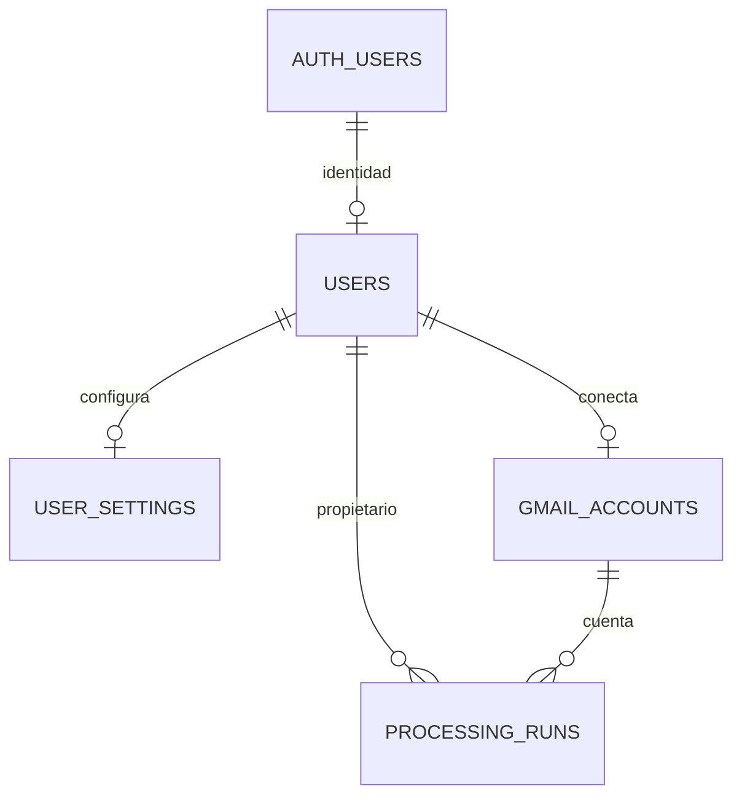

# Persistencia

MAIL-006 implementa el esquema inicial Supabase/PostgreSQL y sus tipos TypeScript. Los adaptadores y repositorios de acceso se incorporarán en MAIL-008.

## Proyecto único

| Dato              | Valor                                            |
| ----------------- | ------------------------------------------------ |
| Proyecto          | `auto-email`                                     |
| Referencia        | `zbcexekelujsqkkynsog`                           |
| Organización      | Ebia                                             |
| Región efectiva   | Irlanda, `eu-west-1`                             |
| PostgreSQL remoto | 17.11.0.003                                      |
| Uso               | Un mismo proyecto para dev, staging y producción |

La decisión del usuario de compartir proyecto, comunicada durante MAIL-006, sustituye la separación de proyectos propuesta en EPIC-00 para este despliegue. No se han creado ramas ni proyectos adicionales. La referencia y URL públicas están en [supabase/project.json](../../supabase/project.json), sin secretos.

## Modelo inicial



| Tabla             | Identidad y relaciones                                            | Reglas principales                                                    |
| ----------------- | ----------------------------------------------------------------- | --------------------------------------------------------------------- |
| `users`           | UUID `id` vinculado a `auth.users.id`                             | Estado y timestamps; la baja Auth propaga el borrado                  |
| `gmail_accounts`  | UUID generado; FK `user_id`                                       | Una cuenta por usuario y un titular por email normalizado             |
| `user_settings`   | UUID `user_id` como PK/FK, sin identificador redundante           | Automatización apagada, polling de 300 s, límite de 30 borradores/día |
| `processing_runs` | UUID generado; FK de usuario y FK compuesta de cuenta/propietario | Estados, fechas y contadores consistentes; errores categóricos        |

Todas las tablas tienen `created_at` y `updated_at` con zona horaria; los triggers actualizan `updated_at`. Los índices cubren propietario, cuenta, fechas de ejecución y sincronización.

`processing_runs` representa una ejecución agregada de una cuenta. Los trabajos por mensaje, su idempotencia y el índice único `(account_id, target_message_id)` corresponden a `email_jobs` en MAIL-031; no se mezclan ambos conceptos.

`public.users` es la identidad de la aplicación, no una segunda implementación de Supabase Auth. Solo referencia la PK estable de `auth.users`. MAIL-007 implementará el alta funcional y su asociación con ajustes; esta migración no instala todavía un trigger de registro de usuarios.

## Seguridad y contenido permitido

Las cuatro tablas tienen RLS y políticas de lectura por propietario preparadas. Se han revocado todos los privilegios de tabla de `PUBLIC`, `anon` y `authenticated`; esas políticas por sí solas no conceden acceso. Inicialmente solo `service_role` dispone de CRUD.

MAIL-008 deberá conceder únicamente las operaciones y columnas necesarias, validar propietario también desde backend/worker y mantener credenciales fuera del navegador. La FK compuesta de ejecuciones impide asociar una cuenta a un usuario diferente incluso mediante una inserción privilegiada. `service_role` puede saltarse RLS: no sustituye las comprobaciones del servidor.

`encrypted_refresh_token` es una columna `bytea` nullable reservada para ciphertext. La implementación de cifrado, claves y revocación corresponde a MAIL-013; un tipo binario no garantiza que su contenido esté cifrado. El cliente no tiene acceso a esa columna. No conceder lectura de toda `gmail_accounts` al habilitar los repositorios.

No existen campos para cuerpos de email, MIME, prompts o textos completos de borradores. Los datos se limitan a configuración, referencias y metadatos. `error_code` admite códigos categóricos, no mensajes libres que puedan incluir información privada.

## Migraciones y validación local

La migración inicial es [20261015172612_mail006_initial_schema.sql](../../supabase/migrations/20261015172612_mail006_initial_schema.sql). Su versión coincide con el historial del proyecto remoto; el contenido se validó antes de aplicarlo.

Requisitos: `npm ci` y Docker Desktop con contenedores Linux. La CLI está fijada como dependencia de desarrollo (`supabase` 2.121.0).

```powershell
npm run db:start
npm run db:reset
npm run db:check
npm run db:types
npm run format
npm run db:stop
```

Los comandos de reset, lint, tests y tipos seleccionan expresamente la base local. `db:reset` destruye los datos de esa base temporal y la reconstruye desde cero. El seed es exclusivamente sintético y no se despliega al proyecto remoto. Los 47 tests pgTAP ejecutan sus cambios dentro de una transacción con `ROLLBACK`, incluidas concesiones temporales para probar las políticas.

Los puertos `55320`–`55324` y el identificador Docker `auto-email` permiten convivir con otros proyectos locales. No se debe detener ni reiniciar todos los proyectos a la vez.

`database.types.ts` se genera desde el esquema y se versiona; `db:types` reemplaza el archivo solo si la CLI devuelve un resultado válido. No editar esos tipos a mano.

## Aplicación de futuras migraciones al proyecto compartido

La migración inicial ya está aplicada a `auto-email` mediante el conector de Supabase. No hay que repetirla en SQL Editor.

Para usar la CLI en cambios futuros, iniciar sesión de forma interactiva y vincular explícitamente el único proyecto:

```powershell
npm exec -- supabase login
npm exec -- supabase link --project-ref zbcexekelujsqkkynsog
npm exec -- supabase migration list --linked
npm exec -- supabase db push --linked --dry-run
```

Tras revisar el destino y las migraciones pendientes, `npm exec -- supabase db push --linked` aplica los cambios al proyecto compartido. No añadir `--include-seed`. No ejecutar `db reset --linked`, `--db-url` con una URL remota, ni reparaciones de historial para forzar migraciones que ya estén aplicadas.

Si se aplican migraciones con el conector, conservar en el repositorio el mismo identificador de versión que figure en su historial remoto antes de usar `db push`. Las contraseñas y tokens de la CLI se gestionan fuera del repositorio; `.temp/` queda ignorado.

La [comprobación remota transaccional](../../supabase/checks/remote-smoke.sql) permite validar inserción, consulta y restricciones sin conservar datos de prueba. Se ejecutó en MAIL-006 y se confirmó que no quedó ningún usuario sintético.

Referencias: [migraciones de Supabase](https://supabase.com/docs/guides/deployment/database-migrations), [modelo de usuarios](https://supabase.com/docs/guides/auth/managing-user-data), [RLS](https://supabase.com/docs/guides/database/postgres/row-level-security).
